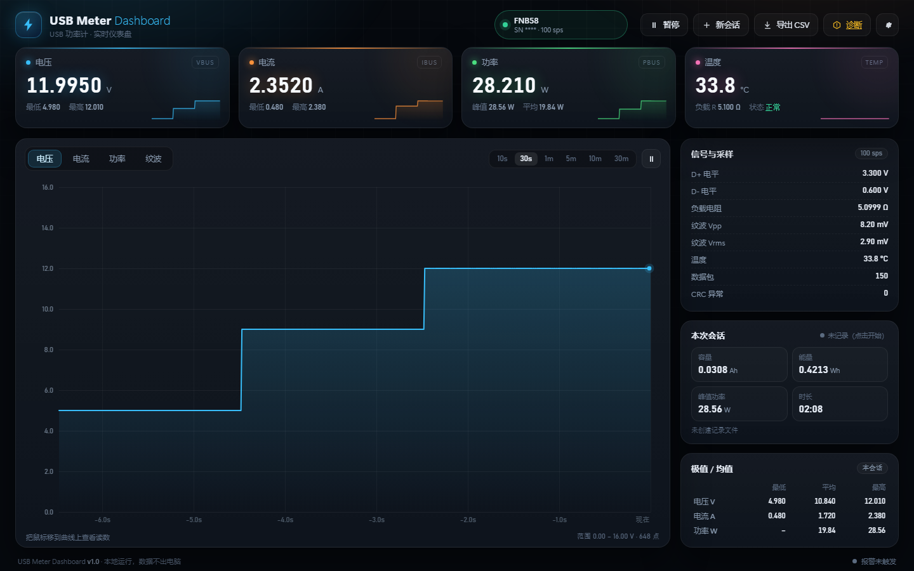

# USB Meter Dashboard

给 **FNIRSI FNB58 / FNB48S / FNB48 / C1** 用的第三方上位机。
官方 `UsbMeterTool` 的悬浮小窗口和老式曲线不好用，所以按 USB HID 协议重做了一个仪表盘，
绿色便携、免安装，双击就能跑。

> 想改代码 / 加功能：先读 [`AGENTS.md`](AGENTS.md)，里面有文件地图、数据流、API 和改动配方。



## 特性

- **实时读数**：电压 / 电流 / 功率 / 温度，100 sps，大字号 + 迷你趋势线
- **曲线**：电压 / 电流 / 功率 / 纹波，10s / 30s / 1m / 5m / 10m / 30m 时间窗，悬停读数、冻结画面
- **会话统计**：最低 / 平均 / 最高、峰值功率、容量（Ah）、能量（Wh）、运行时长
- **实时纹波**：交流耦合显示，Vpp / Vrms 实时计算（受 100 sps 限制，见下文）
- **可选记录**：默认不写文件，点「未记录（点击开始）」才开始写 CSV，可一键导出
- **阈值报警**：过压 / 过流 / 过功率 / 过温，卡片闪烁 + 提示音
- **仪表平滑**：设置里可选 关 / 弱 / 中 / 强，读数不再乱跳，曲线与记录保持原始值
- **控制台读数窗口**：启动时额外弹一个 CMD 窗口，不打开网页也能看
- **诊断页面**：HID 设备、报告长度、事件日志、原始 64 字节包
- **局域网访问**：手机 / 平板 / 其它电脑打开网页即可看
- **免安装**：内置 Python 运行时与 hidapi，不写注册表、不装驱动

## 快速开始

1. 用 **USB-C 数据线**把仪表接到电脑（有些线只能充电，不能传数据）
2. 双击 `start.bat`
3. 浏览器打开 `http://127.0.0.1:8765/`；同一局域网用 `http://<这台电脑的IP>:8765/`

启动时会额外打开一个「USB Meter Dashboard - 实时读数」CMD 窗口，显示电压 / 电流 / 功率。

要求：**64 位 Windows 10/11**，不需要安装 Python，也不需要装驱动。

## 命令行参数

```bat
runtime\python.exe app.py                    :: 启动服务 + 实时读数窗口
runtime\python.exe app.py --browser          :: 启动后自动打开浏览器
runtime\python.exe app.py --no-console       :: 不弹实时读数窗口
runtime\python.exe app.py --host 127.0.0.1   :: 只允许本机访问
runtime\python.exe app.py --port 9000        :: 换端口
runtime\python.exe app.py --no-poll          :: 不发每秒一次的 AA83 周期请求（排查掉线用）
runtime\python.exe app.py --probe            :: 列出 HID 设备后退出
```

辅助工具：

| 工具 | 用途 |
| --- | --- |
| `tools\live.py` | 单独的实时读数控制台窗口，可连远程：`--url http://<IP>:8765`；主程序关闭后窗口会自动退出 |
| `tools\dump.py` | 抓 40 个原始数据包并解析，存到 `logs\raw-*.bin` |

## 界面

| 区域 | 说明 |
| --- | --- |
| 顶部 | 设备状态、SN、采样率、暂停、新会话、导出 CSV、诊断 |
| 指标卡 | 电压、电流、功率、温度，含本会话极值与 30s 趋势线 |
| 主曲线 | 电压 / 电流 / 功率 / 纹波切换；时间窗 10s–30m |
| 右侧 | D+/D-、负载电阻、纹波 Vpp/Vrms、容量、能量、峰值、极值均值 |

快捷键：`空格` 暂停界面、`N` 新会话、`E` 导出 CSV、`D` 打开诊断页面。

## 设置

右上角齿轮打开，保存后立即生效，并写入 `config.json`：

| 项 | 说明 |
| --- | --- |
| 过压 / 过流 / 过功率 / 过温报警 | 超过阈值时卡片闪烁，可选提示音 |
| 仪表平滑 | 关 / 弱(0.3s) / 中(1s) / 强(3s) / 更强(5s) / 极强(10s)：只平滑页面大数字、趋势线控制台显示，曲线与 CSV 仍是原始采样 |
| 服务端口 | 在网页里直接改监听端口（1024–65535），保存后页面自动跳转到新地址，旧地址失效；端口会记住，下次启动沿用 |
| 报警提示音 | 报警时是否发声 |

## 实时纹波

曲线切到「纹波」：用最近 2 秒的电压均值做直流基线，只画交流波动（单位 mV，带 0 轴），
右侧显示 **纹波 Vpp**（峰峰值）和 **纹波 Vrms**（有效值），控制台窗口也会多一行。

> **限制**：USB 协议固定 100 sps，按采样定理只能反映 **≤50 Hz** 的波动。
> 100 Hz 整流纹波正好在奈奎斯特频率上，会混叠，Vpp 可能明显偏小甚至为 0。
> 开关电源几十 kHz～MHz 的纹波要用仪表自带的「高速纹波（AC 耦合）」模式（最高 3.2 Msps），
> 那是表屏幕自己采样的，USB 链路拿不到那么高的采样率。

## 数据文件

- **默认不记录**，只显示实时图表；点右侧「本次会话」里的「未记录（点击开始）」才开始写 CSV
- 记录文件固定放在**程序目录下的 `logs\`**（解压出来的文件夹里），不会写到 C 盘其它位置
- 命名：`session-YYYYmmdd-HHMMSS.csv`；点「新会话」会新建文件，旧文件保留
- 列：时间、经过秒数、电压、电流、功率、D+、D-、温度、电阻、累计能量、累计容量
- 「导出 CSV」下载当前文件副本；没开始记录时会提示先开始
- 设置保存在同目录的 `config.json`（报警阈值、温度单位、时间窗、平滑）

> 100 sps 记录时约 10 KB/秒（35–40 MB/小时），长时间挂机建议分段记录。

## 局域网访问

默认监听 `0.0.0.0:8765`，同一局域网的设备可以直接打开：

```
http://<这台电脑的IP>:8765/
```

启动窗口会打印可用的局域网地址。第一次运行时 Windows 可能弹出防火墙提示，勾选「专用网络」并允许。

- 只想本机使用：`start.bat --host 127.0.0.1`
- 程序**没有登录和密码**：能访问该端口的人都能看数据、下载 CSV、改设置
- 只在可信局域网内使用，不要映射到公网

## 诊断与排错

浏览器打开 `http://127.0.0.1:8765/debug`，可以看到：

- 连接状态、最近错误、事件日志（打开设备 / 写命令 / 收首包 / 超时 / 重连）
- 仪表本身的名称、SN、VID:PID、usage、报告长度（默认显示真实值；开启「隐私模式」后打码，并隐藏其他 HID 设备）
- 最近 24 个原始 64 字节包（十六进制 + 解析值）

右上角可「复制诊断信息」或「下载 JSON」。

> 「隐私模式」在设置里开关，默认关闭。打开后 SN、VID:PID、设备路径会显示为打码，
> `/debug` 只列仪表、不显示其他 HID 设备，导出的 JSON 同样打码；连接和测量不受影响。

如果设备“假死”（系统里还能看到它，但序列号读不出、写入一直失败），
**软件重置救不回来**——禁用/启用、`pnputil /restart-device` 实测都无效，还会让设备从总线上消失。
这种情况只能**拔插一次 USB 线**。`/debug` 里可以看到它当前是“已连接”“假死”还是“从系统消失”。

> 所以程序不会自动重置 USB，只会明确提示需要拔插；频繁点「断开设备/重新扫描」也可能触发假死，
> 正常情况下让它一直连着就好。

> 关闭连接后程序会等 2.5 秒再重新打开设备：仪表在句柄关闭后会重新枚举，
> 立刻重开会打开到“半初始化”的实例，写命令会返回 -1。
> 另外 `AA84` 停止命令是推断出来的，默认关闭（`config.json` 里 `stop_cmd` 可开启）；
> 从实测看它并不是必需的，反而可能让设备状态更乱。

常见问题：

| 现象 | 处理 |
| --- | --- |
| 设备列表里没有仪表 | 换数据线、换后置 USB 口、关掉官方上位机 |
| Windows 提示设备不可用/已禁用 | 拔插一次 USB 线；设备管理器里确认不是“已禁用” |
| 连上但没数据 | 看 `/debug` 的事件日志；连续失败时拔插一次 |
| 关掉程序后要拔插才能识别 | 程序关闭时会先发 `AA84` 停止命令再断开；仍不行时在 `/debug` 点「断开设备」再观察，或确认没有重复启动的实例 |
| 重复双击 start.bat | 同端口只允许一个实例，第二个会提示并直接退出 |
| 用一会儿掉线 | 多为接触/供电问题；换线换口，必要时关掉 USB 选择性暂停 |
| 提示 CRC 规则不同 | 固件校验方式不同，程序会自动跳过校验，读数不受影响 |

## USB 协议

| 项目 | 内容 |
| --- | --- |
| 设备 | FNB58 / FNB48S / FNB48 / C1（自动识别） |
| 通道 | USB HID，64 字节报告（含 report id 时 65 字节） |
| 数据包 | `AA 04` + 4 组 × 15 字节 + 1 字节 + CRC8 |
| 每组 | V `u32/1e5`、I `u32/1e5`、D+ `u16/1e3`、D- `u16/1e3`、标志位、温度 `u16/10` |
| 命令 | 初始化 `AA81…8E`、开始 `AA82…96`、周期请求 `AA83…9E` |
| 速率 | 100 sps，一包 4 个样本 |

## 目录结构

```
USB-Meter-Dashboard/
├─ start.bat           双击启动
├─ app.py              启动入口
├─ AGENTS.md           给 AI / 贡献者的代码结构与改动指南
├─ usbmeter/
│  ├─ protocol.py      HID 包解析、CRC8、命令帧
│  ├─ hidlink.py       SetupAPI 枚举 + hidapi 读写
│  ├─ device.py        连接 / 重连 / 读取线程
│  ├─ session.py       统计、纹波、CSV
│  └─ server.py        本地 HTTP + SSE 服务
├─ web/                仪表盘与 /debug 诊断页（原生 HTML/CSS/JS）
├─ tools/              live.py / dump.py
├─ runtime/            内置 Python 3.14 运行时
├─ vendor/             hidapi 扩展模块
├─ tests/              协议与纹波单元测试
└─ 使用说明.txt         三步上手说明
```

## 已知限制

- 协议触发（QC2.0/3.0、FCP、SCP、AFC）与固件升级：控制命令尚未逆向
- 仪表离线曲线导入、蓝牙（BLE）数据源：未实现
- 多设备同屏对比：未实现
- 网页端无鉴权

## 第三方组件

- Python 3.14（embeddable 包，PSF License）
- hidapi（BSD License）
- 协议参考：[baryluk/fnirsi-usb-power-data-logger](https://github.com/baryluk/fnirsi-usb-power-data-logger)、
  [didim99/fnirsi-utils](https://github.com/didim99/fnirsi-utils)、
  [zhiyb/FNB58_mqtt_forwarder](https://github.com/zhiyb/FNB58_mqtt_forwarder)
